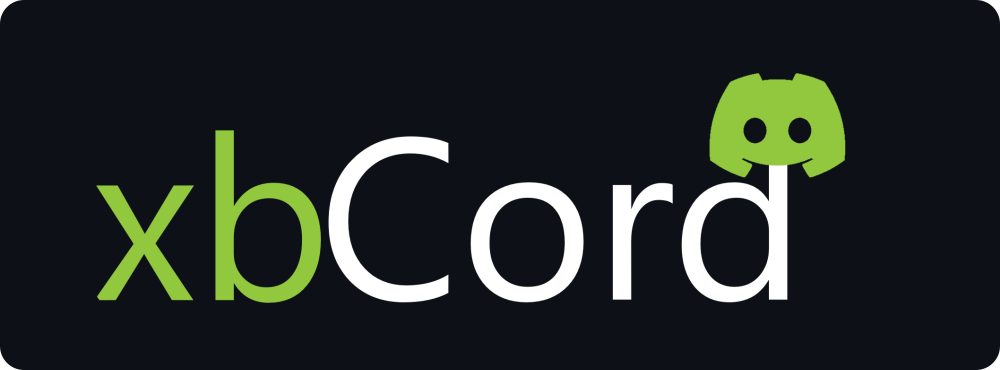

<p align="center">
  
</p>

<h3 align="center">Your chats. Your servers. Your Xbox 360.</h3>

<p align="center">
  A Discord client that lives right inside the Xbox guide.<br>
  Chat with friends, browse your servers and keep your favorites close.
</p>

<p align="center">
  <a href="https://github.com/zuhagames/xbCord/releases/tag/v0.2.1"></a>
  
  <a href="#updating"></a>
  <a href="https://github.com/zuhagames/xbCord/releases"></a>
</p>

<p align="center">
  <a href="https://github.com/zuhagames/xbCord/releases/download/v0.2.1/xbCord.beta.0.2.1.zip"></a>
</p>

<p align="center">
  <a href="#install-in-three-steps">Installation</a> ·
  <a href="#what-you-can-do">Features &amp; controls</a> ·
  <a href="https://github.com/zuhagames/xbCord/releases/tag/v0.2.1">Release notes</a> ·
  <a href="#need-a-hand">Help</a>
</p>

## Download xbCord

**[Download xbCord Beta 0.2.1 (.zip)](https://github.com/zuhagames/xbCord/releases/download/v0.2.1/xbCord.beta.0.2.1.zip)** — the complete plugin, settings template and installation guide.

Extract the ZIP on your PC before copying it to your USB. **Use the release ZIP above**; the green Code button's “Download ZIP” contains repository files rather than the prepared installation package.

> **Before installing:** you need an Xbox 360 already set up to load plugins, such as with DashLaunch. This is a beta prerelease: the SDK build and PC checks passed; physical Xbox boot, upgrade and recovery testing is still needed.

## Install in three steps

1. **Copy the folders.** Open the extracted `xbCord beta 0.2.1` folder, then copy **`Plugins`** and **`xbCord`** to the root of your USB. Copy the entire plugin folder, including `slot-a`.
2. **Set your plugin path.** In DashLaunch, choose `Usb:\Plugins\xbCord\xbCord.xex` in a free plugin slot and save. Keep your other plugins as they are and load xbCord only once.
3. **Restart and sign in.** Keep the USB connected, restart, open the Xbox guide and select **xbCord** under Games & Apps. Choose **Type the token**, or replace all placeholder text in `xbCord\token.txt` with your Discord token and choose **Log in from USB**.

**Already using xbCord?** Back up your installation first. Keep your existing `xbCord.ini`, `token.bin` and `state.txt`; don't overwrite your token with the template. If upgrading manually from a loader build, replace the complete `Plugins\xbCord` folder so old slot-selection files aren't carried over. The separate `xbCord` folder holds your account data and preferences.

<details>
<summary><strong>Check the USB folder layout</strong></summary>

```text
USB root/
├── Plugins/
│   └── xbCord/
│       ├── xbCord.xex              ← choose this in DashLaunch
│       ├── xbCord.xur
│       └── slot-a/                 ← keep all files inside
│           ├── xbCord-core.xex
│           ├── xbCord.xur
│           ├── release.manifest
│           ├── release.sig
│           └── ready.marker
└── xbCord/
    ├── xbCord.ini
    └── token.txt                   ← replace the placeholder to sign in
```

`token.bin`, `state.txt` and logs are created by xbCord as needed. Keep the USB connected while using the plugin.

</details>

For the full instructions, read **[INSTALL-XBCORD.txt](INSTALL-XBCORD.txt)**, also included in the download.

## What you can do

| Feature | How to use it |
| --- | --- |
| **Chats, servers & channels** | Open conversations and browse your Discord servers from the Xbox guide. |
| **Search by name** | Click the **left stick (LS)** in the current chat, server or channel list. |
| **Unread filter** | Press **BACK** to show unread conversations. **B** clears active filters. |
| **Pinned favorites** | Press **START** to pin a chat, server or channel. In **Pinned**, click **LS** to rename or move it up/down. |
| **Quick messages** | Press **X** in an open chat to choose a phrase. Customize them under **Settings → Quick messages**. |
| **Edit & delete** | Select one of your messages and press **A**. Deleting asks for confirmation. |
| **Notification privacy** | Under **Settings → Notification privacy**, choose message previews, sender only or “New Discord message.” |
| **Connection diagnostics** | Check network, authentication and verification results from **Settings** or the sign-in screen. |
| **In-app updates** | Open **Settings → Updates** to check and download from GitHub. |

## Updating

Once the complete loader package is installed:

1. Open **Settings → Updates → Check for updates**.
2. Choose **Download update** and wait for **“Update downloaded and verified.”**
3. Restart when convenient. Allow at least **one minute** for startup confirmation.

Downloads are checked against signed update metadata and file hashes. The previous plugin slot stays available: if a trial startup isn't confirmed, restarting again selects the previous slot. Updates preserve your account data and settings, and never force a restart.

The normal release channel is `update_channel=beta` in `xbCord/xbCord.ini`.

<details>
<summary><strong>Developer updater test — 0.2.0.1</strong></summary>

[Download the 0.2.0.1 developer updater test](https://github.com/zuhagames/xbCord/releases/tag/v0.2.0.1-dev.1) if you specifically want to test upgrading from that build. Install its complete package once, then use **Settings → Updates** to discover 0.2.1 through the developer feed.

Use `update_channel=dev` for the developer feed. Most new installations should use the 0.2.1 download at the top of this page.

</details>

## Need a hand?

| Problem | Start here |
| --- | --- |
| **xbCord doesn't appear** | Check the saved plugin path, keep the USB connected and confirm your plugin loader is running. Copy the complete plugin folder. |
| **It can't connect** | Open **Connection diagnostics** to see whether DNS, TCP, TLS, authentication or account verification failed. |
| **The token isn't accepted** | Replace the entire placeholder in `token.txt` with your complete current token on one line. Your Discord account password is different from a token. |
| **Discord asks for verification** | Complete the checks in the official Discord app, then choose **Retry sign-in** in xbCord's Account help. |
| **You need to disable it** | Create an empty `xbCord_off.txt` at the USB root and restart. Remove it when ready to enable xbCord again. |

See the **[installation guide](INSTALL-XBCORD.txt)** for recovery instructions. If you share logs for support, **never include token files or your token**.

---

<p align="center">
  <strong>Made by zuha | zec2235</strong><br>
  Published by <a href="https://github.com/zuhagames">ZuhaGames</a>
</p>
